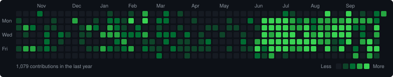

<p align="center">
  
</p>

```bash
haseeb@github:~$ whoami
Muhammad Haseeb, full-stack developer

haseeb@github:~$ cat stack.yml
backend   : Ruby on Rails (API mode), PostgreSQL, Devise + JWT
frontend  : React, TypeScript, Vite, Tailwind CSS, shadcn/ui, Material UI
python    : Django, scraping and automation scripts
platform  : Supabase, Cloudflare Workers, Docker, Linux
practice  : DSA in Python, C++ and Ruby

haseeb@github:~$ ls ./projects
MyBlog-ReactTS-Rails/   FinanceTracker/   MessageMeApp/
LinkedIn_clone/         PU-Result-Scrapper/   dsa-practice/

haseeb@github:~$ cat now.txt
building     : unLocked CRM, an all-in-one CRM for insurance agents
side project : resume analyzer, a Rails API that parses PDF resumes

haseeb@github:~$ cat unlocked-crm/README
stack     : React, TypeScript, Vite, shadcn/ui, Tailwind
backend   : Supabase (Postgres + RLS), Drizzle, Cloudflare Workers
comms     : Twilio Voice, SMS, Resend email campaigns
payments  : Stripe
features  : leads, policies, commissions, visual automations,
            unified inbox, AI assistant and agents,
            multi-tenant sub-accounts, website builder
testing   : Playwright, Vitest
```

<p>&#128279; <a href="https://app.unlockedcrm.ai"><b>unLocked CRM</b></a></p>

<p>
  
  
  
  
  
  
  
  
  
  
  
</p>

<!-- stats:start -->
```bash
haseeb@github:~$ gh stats --all-time
total contributions .... 378
commits ................ 353
pull requests .......... 277
merged PRs ............. 255 (92%)
repositories ........... 21
```
<!-- stats:end -->

```bash
haseeb@github:~$ gh streak --user Mhasxxb
```

<p>
  
</p>

```bash
haseeb@github:~$ git log --graph --since="1 year ago"
```

<p>
  
</p>

```bash
haseeb@github:~$ echo "thanks for stopping by"
thanks for stopping by
```
